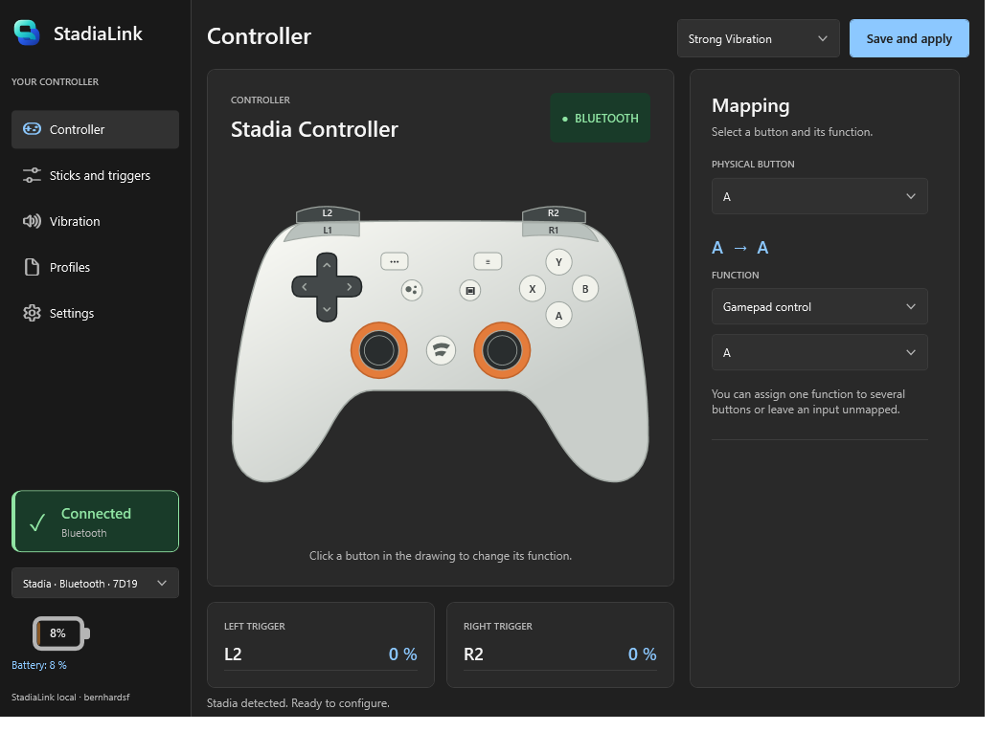
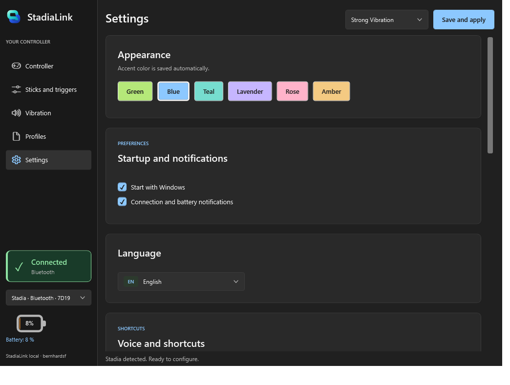
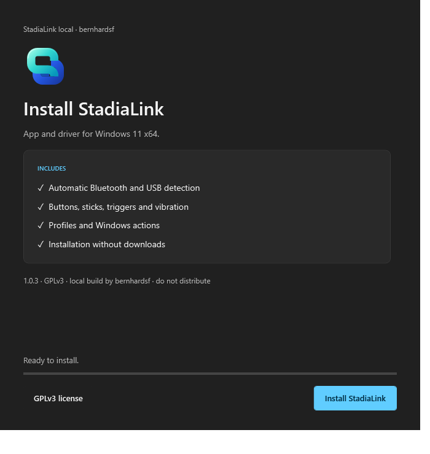
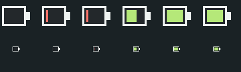

  

# StadiaLink

Configure your Stadia controller on **Windows 11 x64**. Button mapping, keyboard shortcuts, stick and trigger tuning, vibration, profiles, and battery status over USB or Bluetooth.

**1.0.4 · Personal fork · GPL-3.0**

## What’s new

- Fluent-inspired dark interface, resizable layouts, and a clearer connection indicator.
- Six saved accent colors and a more faithful Stadia controller illustration.
- New teal/blue app icon and refreshed setup, update, and uninstall screens.
- Live battery tray icon with low-battery color, charging indicator, and exact percentage on hover. Click to reopen the app.

Settings, installer, and battery icons

App screenshots are from 1.0.4. The installer image shows the shared redesign. Battery icons are rendered test samples.

## Install or update

Use the binaries from **this fork’s build**, not the upstream project’s release:

- **`StadiaLink.Setup.exe`**: app and driver installation. Driver installation requires administrator access.
- **`StadiaLink.Update.exe`**: app-only update that preserves profiles and checks driver compatibility. It does not install a new driver.

Build outputs are in `release/`. Compare `Get-FileHash .\StadiaLink.Setup.exe -Algorithm SHA256` with the matching `SHA256SUMS.txt`. A matching hash verifies the file against that checksum, not that the software is safe.

Connect by USB or pair in Windows Bluetooth settings. Bluetooth requires a controller already converted to Bluetooth mode. StadiaLink does not change controller firmware.

## Driver security: read before installing

> [!WARNING]
> This is a locally signed **UMDF user-mode driver**, not a Microsoft-certified driver package. Setup runs privileged installation code, creates a signing certificate, and adds it to the machine-wide **Trusted Root** and **Trusted Publishers** stores. The script deletes its signing private key afterward, but certificate trust remains while installed. This changes your computer’s trust configuration; signing does not prove the code is safe. Bugs can also disrupt controller input.

**Safer options:** keep the Windows HID driver and use games with native controller support, or try [Steam Input](https://partner.steamgames.com/doc/features/steam_controller/device). Compatibility and vibration may differ. You can also explore the HTML prototypes without installing anything. Test experimental drivers on a spare PC rather than a machine holding sensitive data.

**If Windows blocks installation, stop and inspect the error.** Do not disable Secure Boot, Memory Integrity, Defender, or signature enforcement just to make it install. This installer does not require those switches in its script; local signing is not a guarantee that every Windows policy will accept it. Review the source and use a properly signed, compatible driver if needed. See [Microsoft’s driver-signing guidance](https://learn.microsoft.com/en-us/windows-hardware/drivers/install/driver-signing).

**Undo the driver installation:** from the source folder, run `.\driver\install.ps1 -Uninstall` in administrator PowerShell, then reconnect the controller. The script removes StadiaLink driver packages and their local signing certificates, returning the controller to Windows HID. Remove the app through **Installed apps**.

## Explore or build

Open these files locally in a browser. They are interactive demonstrations, not hardware controls:

- [App prototype](design/prototype/preview.html)
- [Installer prototype](design/prototype/installer.html)
- [Icon and branding](design/prototype/brand.html)

[Build instructions](docs/BUILD.md) · [Design coverage](design/prototype/COVERAGE.md) · [Changelog](CHANGELOG.md)

Profiles: `%LOCALAPPDATA%\StadiaStudio\profiles.json`. Bluetooth rumble uses private Windows interfaces and may break with OS updates. USB is treated as charging; this is not a measurement of charging current.

Based on [aisk/WinStadia](https://github.com/aisk/WinStadia), with StadiaLink modifications. [GPL-3.0](LICENSE) · [Upstream credits](UPSTREAM-README.md). Independent of Google and Microsoft.
